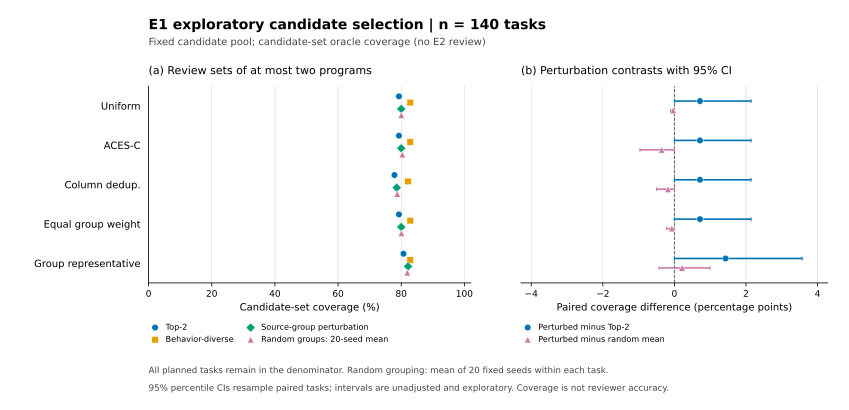

## Material Passport

- Origin Skill: ARS academic-research-suite / experiment-agent
- Origin Mode: run + validate（本地實驗、離線配對分析）
- Origin Date: 2026-10-19，Asia/Shanghai
- Verification Status: ANALYZED；選擇重播及數值核算另有憑證，未獨立重跑完整自然生成
- Version Label: e0-e1-experiment-v1
- Repro Lock: null；設定、模型檔案、資料、環境與每階段雜湊憑證另存於 artifacts
- Upstream: docs/research/research-report.md，SHA-256 `60ef2ace60b6112418332a0e6284ea198e29cbc0875944b35a19d61c83c61f39`

## 執行範圍

將原研究報告的 E0–E1 交接實作為可執行管線。E0 的 20 題及 E1 的 140 題已完成生成、執行、選擇、官方隱藏評測及分析。模型與資料均在本地執行，沒有發起付費模型 API 調用。E2 真實審核尚未執行。

目前存在剩餘選擇錯誤，但沒有建立真實來源分組超越簡單對照的候選覆蓋優勢。以 ACES-C 為例，來源擾動為 112/140，Top-2 為 111/140，行為多樣性為 116/140，隨機分組均值為 112.5/140。這是單模型開發探索，不能據此證明方法普遍無效。

實驗設定為每題 16 個候選、8 次測試生成請求，每次最多 8 條測試；temperature=0.7、top-p=0.95、每請求最多 2,048 個輸出 token。候選和測試的每個邏輯請求有獨立固定 RNG seed，實際按每批 24 請求解碼。不同請求不被視為統計獨立的研究樣本。

## 固定協議與實作差異

- 模型為 Qwen/Qwen2.5-Coder-7B-Instruct，revision `c03e6d358207e414f1eca0bb1891e29f1db0e242`，完整 BF16 權重；模型和 tokenizer 檔案的 SHA-256 保存在 artifacts/environment/model.manifest.json。
- 資料為 EvalPlus 0.3.1 的 MBPP+ v0.2.0，原始快照 SHA-256 `b54e762755248ca411b523c917fa9f93c07b5ff2966bf60b3917b853926a3dad`。378 題按預定 task-ID hash 分為 E0=20、E1=140、保留集=218；HumanEval+ 未使用。
- 生成後端為 PyTorch 2.10.0+cu126 / Transformers 5.13.0 的本地 decoder，版本 hf-autoregressive-v1。vLLM 安裝在任何自然生成前停止；未將本次輸出宣稱為 vLLM 重現。生成使用 Python 3.12，程式執行與隱藏評測使用 Python 3.11。
- 公開視圖只包含題目、入口函式、task ID 與 split；不含參考實作、contract、隱藏輸入或標籤。測試僅允許字面值呼叫的單一相等斷言。解析失敗和截斷有紀錄，不按參考答案過濾或補抽。
- 每次可見測試在新的 bubblewrap filesystem/network/PID namespace 內執行；標準庫、0.5 秒程式時限、1 GiB address-space。基礎設施錯誤使階段失敗，不能偽裝為候選失敗。
- 隱藏評測使用官方 untrusted_check kernel、官方 MBPP 輸入還原及特殊 oracle。可信 supervisor 計算參考輸出；每個候選與 suite 的 sandbox 不掛載參考實作、資料檔案或持久結果目錄。這是官方 kernel 的執行包裝，並非原封不動的官方 CLI。
- 五個選擇器為 uniform、ACES-C、dedup_uniform、group_equal、group_rep。ACES-C 使用與原式成比例的精確整數權重；平局 hash 與零權重 fallback 是本項目協議選擇。CodeT、ACES-O 和完整 BACE 沒有實作，不構成其效果復現或完整近鄰比較。
- 三種同預算候選集合為 source-distinct Top-2、最高排名的行為相異候選、來源組刪除擾動候選；均保留原 winner，最多兩個來源互異程式。Raw W 未截斷，另列而不與 k=2 當公平成本比較。
- 隨機對照使用全部 20 個固定種子，匹配解析後的真實組大小。它只改變刪除分組，原始打分與刪組後重新估權仍使用原來源組，確保原 winner 固定。

設定 SHA-256 為 `ff38b4d4676c37cf4066e425c7f276aa3d2bc4e219f6cfb3ccedd1c8f141f9b7`，與第一個自然生成記錄一致。來源碼 commit `898cdea36b93e14666b5800072320ebfa3da52ef` 早於 E0 隱藏評測與 E1 生成。protocol-lock.json 是 E0 後補寫的核對憑證，不是事前公開預註冊。E0 後未修改提示、選擇器、抽樣、排除或成功標準。

## E0 工程結果

全部 480 個請求完成，320 個候選均可解析；1,253/1,280 條請求測試通過固定格式解析。20 題全部留在分母。候選池有正確程式者為 17/20；五選擇器的 Top-2 覆蓋均為 15/20。來源擾動在 dedup_uniform 為 16/20，其他四者為 15/20。

唯一增加覆蓋的題是 Mbpp/294；20 個匹配隨機分組種子全數得到同一候選對。因此這個 E0 gain 不能支持真來源分組的額外資訊價值。Mbpp/446 則存在正確與錯誤候選完整通過行相同的盲區：一個輸入能區分兩類輸出，但生成的錯誤期望值將兩者均記為失敗。詳見 [E0 個案審計](e0-case-audit.md)。

這些個案是工程探索，未併入 E1，也不由兩題推算自然錯誤機制的盛行率。

完整 E0 執行審計發現 36/320 個候選含頂層裸 `python` 表達式，屬輸出格式殘留；「AST 可解析」不代表可成功執行。靜態非標準庫匯入為零，已記錄的 timeout、MemoryError、ImportError、ModuleNotFoundError、ChildProcessExit 亦為零。這些失敗保留在固定候選池，不作事後修補或替換；它們也使本次結果限於這個實際生成／抽取協議。詳見 artifacts/runs/e0-v1/execution-audit.json。

## E1 探索結果

完整 N=140，候選池覆蓋 121/140（86.4%），19 題沒有通過官方測試的候選；所有題目均有 16 個 AST 可解析候選，合計 2,240 個、2,087 份不同來源碼。下表除隨機均值外均為覆蓋題數，分母一律 140；隨機欄是每題先平均 20 個種子所得的等價計數，不是額外題目。

| Selector | 原選正確 | Top-2 | 行為多樣性 | 來源擾動 | 隨機分組均值 | 擾動相對 Top-2 新增／丟失 |
|---|---:|---:|---:|---:|---:|---:|
| uniform | 110 | 111 | 116 | 112 | 112.05 | 1／0 |
| ACES-C | 110 | 111 | 116 | 112 | 112.50 | 1／0 |
| dedup_uniform | 104 | 109 | 115 | 110 | 110.25 | 1／0 |
| group_equal | 110 | 111 | 116 | 112 | 112.10 | 1／0 |
| group_rep | 108 | 113 | 116 | 115 | 114.70 | 2／0 |

下表為來源擾動減去對照的按題配對差及 95% percentile 區間，單位為百分點。五個 selector 都完整報告；區間未作多重校正，不作確認性顯著主張。

| Selector | 相對 Top-2 | 相對行為多樣性 | 相對隨機均值 |
|---|---:|---:|---:|
| uniform | +0.71 [0.00, 2.14] | −2.86 [−6.43, 0.00] | −0.04 [−0.11, 0.00] |
| ACES-C | +0.71 [0.00, 2.14] | −2.86 [−6.43, 0.00] | −0.36 [−0.96, 0.00] |
| dedup_uniform | +0.71 [0.00, 2.14] | −3.57 [−7.14, 0.00] | −0.18 [−0.50, 0.00] |
| group_equal | +0.71 [0.00, 2.14] | −2.86 [−6.43, 0.00] | −0.07 [−0.21, 0.00] |
| group_rep | +1.43 [0.00, 3.57] | −0.71 [−2.86, 1.43] | +0.21 [−0.43, 1.00] |

ACES-C 原選錯而池中有正確程式者有 11/140 題，來源擾動的完美集合內救援上限 U=2/140，行為多樣性 U=6/140。11題包含零可見測試題，不能當成純語義選擇錯誤的盛行率。各 selector 有 125–136/140 題未產生替代來源碼赢家，2–3 題存在原錯誤赢家與正確候選完整執行行相同的盲區。這些計數支持 H1 的剩餘空間，也顯示刪組通常沒有提供新候選；不能把穩定性當成正確性。

全部新增覆蓋只有三個 task ID：四個 selector 共同增加 Mbpp/787，group_rep 增加 Mbpp/459、Mbpp/734；沒有相對 Top-2 的丟失覆蓋。三題的行為多樣性對照均已覆蓋正確候選；匹配隨機分組分別在20/20、12/20、20/20個種子覆蓋。刪組後平局與固定 hash 的作用已列入個案審計，沒有把 winner 翻轉本身當成語義錯誤來源證據。

E1 的完整執行矩陣共有 138,464 個候選×測試單元：82,783 pass、30,786 assertion_fail、24,823 program_error、72 timeout。319/2,240 個候選含頂層裸 `python`；一個非標準庫候選產生 64 個 ModuleNotFoundError。72 次 timeout 涉及 22 個候選、4 題；沒有記錄到 MemoryError、ImportError 或 ChildProcessExit。這些是可見執行狀態，不能直接推定隱藏評測正確性。詳見 [E1 執行審計](../artifacts/runs/e1-v1/execution-audit.json) 與 [E1 個案審計](e1-case-audit.md)。

Mbpp/563 的 8 批測試均未通過格式解析，是唯一零可見測試題，仍保留在 N=140。其排名僅由固定平局規則決定。另三題的 timeout 所在列對全部候選都是0；Mbpp/765 則存在能區分候選的 timeout 列。未將這些執行事件一律歸因為期望輸出錯誤，也未按隱藏標籤事後調整環境。

完整數值見 [E1 結果表](../artifacts/runs/e1-v1/results.md)，逐題資料見 [task_metrics.jsonl](../artifacts/runs/e1-v1/task_metrics.jsonl)。



## 執行與成本

Run ID 分別為 e0-v1、e1-v1，類型為自然生成與離線分析，主階段狀態均 completed、exit code=0。工作目錄為 `/home/zhangyudong/FDU/paper/Eval`；逐階段完整命令、UTC起訖、硬時限與監控觀察值見各 run 的 `*.process.json`。可執行命令亦列於 README。下列時間為實際 stage wall seconds，不是候選子程序累積時間或 GPU active time。

| 指標 | E0 | E1 |
|---|---:|---:|
| 題數 | 20 | 140 |
| 生成請求 | 480 | 3,360 |
| 輸入 token | 81,248 | 569,072 |
| 輸出 token | 61,641 | 451,391 |
| 解析後可見測試 | 1,253 | 8,654 |
| 候選×測試執行單元 | 20,048 | 138,464 |
| 生成秒數 | 146.762 | 1,335.585 |
| 矩陣秒數 | 178.248 | 1,426.023 |
| 首次選擇秒數 | 9.805 | 65.216 |
| 官方隱藏評測秒數 | 22.281 | 182.211 |
| 觀察到的整卡顯存峰值 MiB | 17,663 | 62,099 |

總計 3,840 次本地請求、1,163,352 個輸入加輸出 token、2,560 個候選、158,512 個可見執行單元。E1 有4次測試生成達長度上限，整批按規則棄用並記錄，不補抽。付費 API 調用及費用為0；GPU硬體、電力與配額成本沒有估價，不能稱整個研究零成本。顯存為約30秒間隔的整卡觀察值，可能漏過瞬時峰值，也不能精確歸因到本程序。

## 驗證與可重算性

核心／實際 sandbox／官方 kernel／歸檔回歸測試為 120 passed、1 個可選依賴跳過；生成環境另跑該後端的 15 項測試，全數通過。生成後端含不下載權重的 tiny 隨機 Qwen CPU cache/left-padding 實測。唯讀功能審查亦核對了所有 378 題的官方輸入還原、20/140/218 分母、隨機刪組對照與題目層級 bootstrap。審查發現的最後一題超預算仍發布成功之缺口，已在隱藏評測前修正並新增紅綠回歸測試。

E0、E1 都從凍結矩陣重播全部選擇，各自 SHA-256 完全相同。另一支算術程式從已提交的 task_metrics.jsonl 分別重算全部 15 組配對差、95% percentile 區間及 coverage 計數，與 summary.json 一致。這核驗了該範圍的確定性重播／核算，不等於在獨立環境重跑整個自然生成和官方評測。整體解讀信心為 CAUTION：執行與算術證據充分，外推效力及實際審核效果仍未驗證。

```bash
.local/eval-venv/bin/python scripts/check_compact_results.py --run-dir artifacts/runs/e0-v1
.local/eval-venv/bin/python scripts/check_compact_results.py --run-dir artifacts/runs/e1-v1
```

保存工具另有專門檢查：歸檔拒絕與 manifest 同路徑，成員一律使用可移植相對路徑，並逐檔解壓重算雜湊。數值核算以顯式例外取代可被 Python 最佳化停用的 assert，同時檢查計數、分母與比例。E0 原始數值在一般及最佳化模式均一致，663 個臨時指標竄改反例全被拒絕。這些測試資料沒有進入自然實驗統計。

GitHub 包含來源、協議、環境、完整逐題指標及其來源雜湊；大型原始生成、逐測試執行及隱藏評測紀錄以獨立壓縮歸檔保存。歸檔不含官方隱藏輸入、參考實作或原始 benchmark 快照。單獨 clone 可核算已報數字，但不能據此宣稱已重新執行模型或官方 kernel。

歸檔為 `e0-e1-v1-raw.tar.gz`，10,470,624 bytes，SHA-256 `0157011667eaea33a7f58f34385bdb153470783307e19a97d28bc6b7eeb5a7f2`。16個成員均解壓重算並符合凍結雜湊；[成員清單](../artifacts/archives/e0-e1-v1-raw.manifest.json) 隨來源提交，原始資料在私有 GitHub 的 [e0-e1-v1 發布附件](https://github.com/Freezingc/test-group-selection/releases/tag/e0-e1-v1) 保存。

## 統計方法與 11/11 謬誤檢查

統計單位是題目，使用 seed=20261019 的 10,000 次整題配對 percentile bootstrap。隨機分組先在每題平均全部 20 個種子，再重採樣題目。所有空候選池和失敗候選照原規則保留；比較區間未作多重校正，全部解讀為探索性描述。若所有觀測配對差皆為零，經驗 bootstrap 會退化成 [0,0]，不能證明母體差異為零或方法等效。

| 謬誤類型 | 本次處理與限制 |
|---|---|
| Simpson's paradox | 五個 selector 分別報告；E0/E1 分開，沒有合併跨資料集效果。 |
| Ecological fallacy | 不將候選、矩陣單元或種子作為獨立題目。 |
| Berkson's paradox | 以固定 hash 選題；剩餘可挽救題／個案子集只供描述，不代表全體盛行率。 |
| Collider bias | 不從條件化於原選錯誤或正確池的子集推導來源依賴因果。 |
| Base-rate neglect | 同時列完整 N、候選池覆蓋、原選準確率、gain/loss 與救援上限。 |
| Regression to the mean | 沒有重抽極端題後宣稱改善；E0 不併入 E1。 |
| Survivorship bias | 解析／截斷／執行失敗有紀錄；未按隱藏結果排除題目。 |
| Look-elsewhere effect | 報全部五 selector 與 20 種子；未以最佳一列作確認性結論。 |
| Garden of forking paths | E1 設定固定並留下改動紀錄；不將開發探索稱為正式預註冊確認。 |
| Correlation versus causation | 同矩陣重新分組衡量演算法資訊增量，不是生成錯誤相關性的因果干預。 |
| Reverse causality | 不由 winner 翻轉反推某來源組必然錯誤或存在共享誤解。 |

## 解讀邊界

候選覆蓋與 U 是完美集合內選擇的潛力，不能解讀為真實審核收益。兩個集合的 coverage 差也不是它們真實審核準確率差的一般上界。E2 需要另定固定審核器、展示方式、回退規則與相同調用／token 預算，並報錯改對、對改錯和淨增益。

本次只有單模型、單候選池 seed 設計與 MBPP+ 開發子集；沒有跨模型／資料集、污染控制或完整近鄰復現。公開任務可能與預訓練重疊；通過有限官方測試不構成語義正確性證明。可見 stdlib/0.5 秒環境與官方 hidden 依賴／時限不同，需檢查是否由環境差異驅動個案，不可自動歸因於測試語義偏差。

140 題探索不足以可靠確認或否定 2 個百分點的小差異。小樣本區間包含零，不等於沒有作用；少量有利案例也不足以建立來源分組優勢。沒有正式預註冊、作者閱讀認證、盲審或跨模型獨立驗證。

## 研究決策與後續條件

H1 在本協議下成立為描述性觀察：強基礎選擇器仍有11題「原選錯、池內正確」。H2 尚未建立：來源擾動在五列均低於行為多樣性點估計；四列也低於隨機均值，group_rep 的隨機增量僅 +0.21 pp、95% CI [−0.43, +1.00]。H3 未測，H4 僅有個案機制線索。這不足以支持擴大到昂貴審核或追加複雜模組，也不能宣稱已證明所有成對審核無效。

目前決策為保存本輪負面／混合證據，暫不啟動 E2 或消耗保留集。若繼續，先以新版本協議共同修正格式抽取、釐清可見／隱藏依賴及輸入域差異，再用新的生成種子做開發重複，完整保留與本版的差異。不能事後只清洗本輪有利候選、刪除失敗題或更換主比較。只有再觀察到簡單對照不能解釋的候選增量，才固定審核器、預算和回退規則進入 E2；若轉向「候選更易被審核」，需另寫假設與評估，不能改寫本次 H2。
